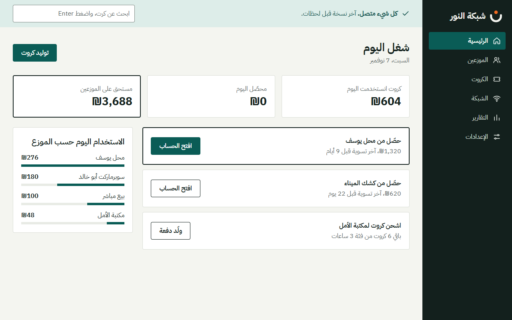
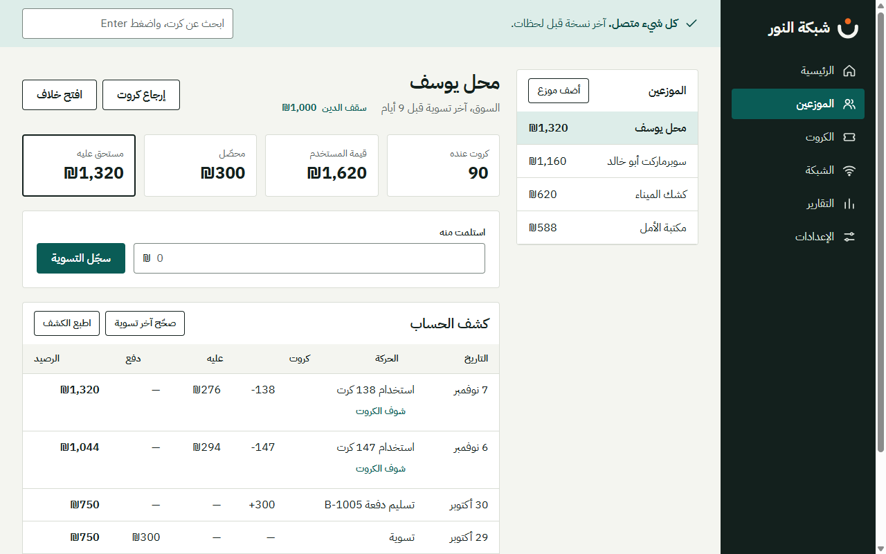
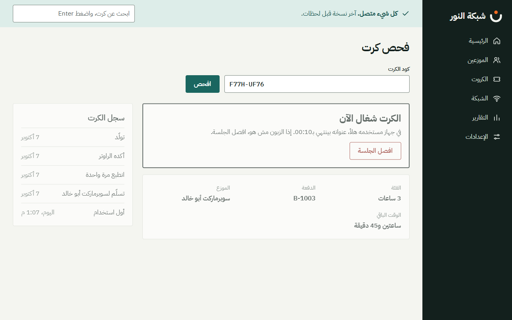
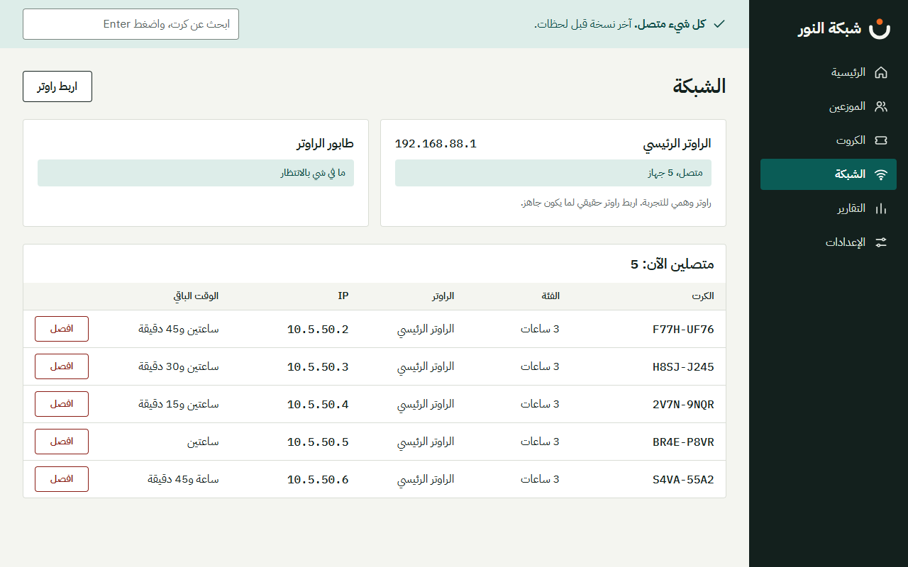
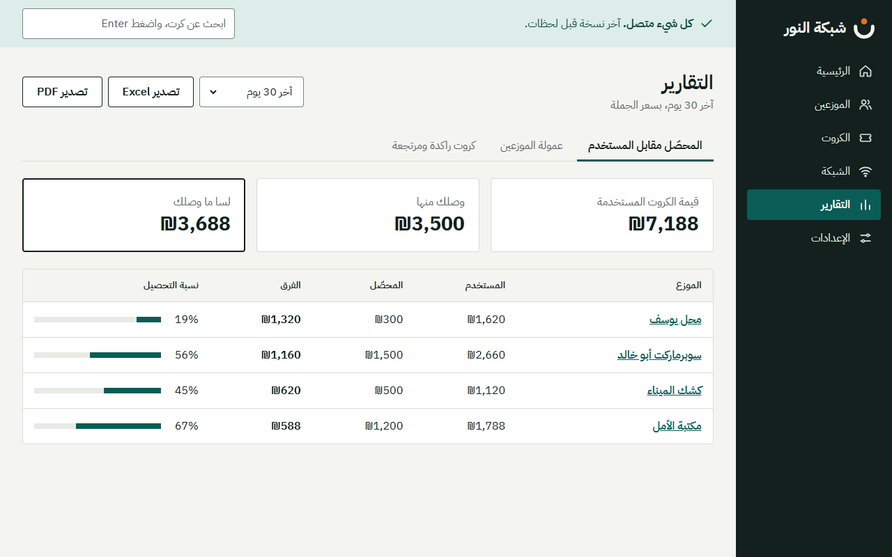

<!-- 1. Header -->
<p align="center">
  
</p>

<p align="center">
  <a href="#-about"></a>
  <a href="#-see-it"></a>
  <a href="#-tools-and-tech"></a>
  <a href="#-run-it"></a>
  <a href="#-security"></a>
  <a href="#-before-launch"></a>
</p>

<p align="center">
  
  
  
  
</p>

Hotspot owners sell internet vouchers through shops and kiosks, then chase who holds how many cards and who owes what, usually on paper. **Nuqta** (نُقطة) keeps that whole business in one desktop app: it creates the cards, sends them to the MikroTik router, prints them, and turns real card usage into a ledger you can trust. No internet needed.

<p align="center">
  
</p>

<!-- 2. About -->
## 💡 About

```yaml
project:   Nuqta (نُقطة)
for:       MikroTik hotspot owners who sell vouchers through distributors
does:
  - generate voucher codes, send them to the router, confirm, print, deliver
  - keep an append-only ledger per distributor, in integer agorot (no floats)
  - read card usage from the router and turn it into debt, once per card
  - settle, return cards, open disputes, correct with linked reverse entries
  - report collected vs used, per-batch commission, and stale cards
  - sign in per user with a PIN, with owner and technician roles and auto lock
works:     fully offline; the router is on the local network
language:  Arabic, right to left
platform:  Windows desktop (Electron)
status:    first version built; 7 of 10 acceptance items automated and passing; no installer yet
```

## 👀 See it

The interface is in Arabic, right to left, built for the people who use it every day.

<p align="center">
  
</p>

<table>
  <tr>
    <td width="50%"></td>
    <td width="50%"></td>
  </tr>
  <tr>
    <td align="center"><b>Distributor account and statement</b></td>
    <td align="center"><b>Card check</b></td>
  </tr>
  <tr>
    <td width="50%"></td>
    <td width="50%"></td>
  </tr>
  <tr>
    <td align="center"><b>Network and live sessions</b></td>
    <td align="center"><b>Reports</b></td>
  </tr>
</table>

<!-- 3. Tools and tech -->
## 🧰 Tools and tech

<p align="center">
  &nbsp;&nbsp;
  &nbsp;&nbsp;
  &nbsp;&nbsp;
  &nbsp;&nbsp;
  &nbsp;&nbsp;
  &nbsp;&nbsp;
  
</p>

| Layer | Tool | Why |
|---|---|---|
| App | Electron 45, React 19, TypeScript (strict) | Arabic desktop app in a sandboxed window with no system access from the UI |
| Database | SQLite through the built-in `node:sqlite` | No native dependency, and triggers block any edit or delete in the ledger |
| Router | RouterOS API over api-ssl | Written from scratch, with certificate pinning and a mock router for development |
| Printing | A hidden print window from the same build | A4 with 12 or 24 cards, thermal 80mm, statements, and PDF reports |
| Sign-in | scrypt-hashed PINs | Roles are enforced in the main process, not in the UI |
| Licensing | Ed25519 | A device code and a signed key that work without internet |
| Testing | Vitest | 315 tests, including the acceptance tests |
| Fonts | IBM Plex Sans Arabic, IBM Plex Mono | Bundled locally, so everything works offline |

<!-- 4. Project history -->
## 📈 Project status

<p align="center">
  
  
  
  
</p>

Acceptance results, from section 12 of [HANDOFF.md](HANDOFF.md). Evidence is in [app/ACCEPTANCE.md](app/ACCEPTANCE.md). Both documents are in Arabic.

| # | Item | Status |
|---|---|---|
| 1 | 1,000 random operations: amount owed equals the ledger total, with no floats | ✅ |
| 2 | Changing a category price leaves every past amount unchanged | ✅ |
| 3 | No way to edit a ledger entry | ✅ |
| 4 | Router cut off mid-batch: no card prints before it's confirmed, and no code is lost | ✅ |
| 5 | A full day offline, then a sync with no duplicates | ✅ for the router |
| 6 | Pressing "record settlement" twice quickly records it once | ✅ |
| 7 | `num()` and `normCode()` match the prototype | ✅ |
| 8 | Arabic printing on A4 and thermal 80mm | 🟡 PDF checked, real printers still to test |
| 9 | Accessibility on the built app | 🟡 Automated audit clean; NVDA and touch need a person |
| 10 | First batch and settlement time targets | ⬜ Needs sessions with real users |

## 🚀 Run it

There's no installer yet, so run it from source:

```bash
git clone https://github.com/mahmoudteirdev/nuqta.git
cd nuqta/app
npm install
npm run dev        # development mode, with demo data and a mock router
npm test           # all tests
npm run build      # build the app
```

The demo data has two users: the owner (PIN `1234`) and a technician, Sami (PIN `5678`). They exist in development mode only. A real install asks the owner to create a PIN after first-run setup.

<details>
<summary><b>Development settings</b></summary>

Packaged builds ignore all of these.

| Variable | What it does |
|---|---|
| `NUQTA_DB` | Use a database at another path |
| `NUQTA_MOCK=1` | Use the mock router even if a real one is saved |
| `NUQTA_NO_SEED=1` | Start without demo data, to see first-run setup |
| `NUQTA_PRINT_PDF_DIR` | Turn all printing into PDF files in this folder |
| `NUQTA_BACKUP_DIR` | Use another backups folder |
| `NUQTA_IMPORT_FILE` | Import a file without the file dialog |
| `NUQTA_MACHINE_ID` | Use a made-up machine ID |
| `NUQTA_INSTALLED_AT` | Use a made-up install date |

</details>

<details>
<summary><b>Project structure</b></summary>

```text
HANDOFF.md            design handoff: the source for behaviour and decisions
reference/            the interactive prototype
screens/ tokens/ ...  screens, colours, and components from the design
docs/readme/          the animated README images and the script that makes them
app/
  src/shared/         money, ledger, and codes: pure and tested
  src/main/           database, router, printing, backups, licensing, sign-in
  src/renderer/       the interface and the print page
  scripts/            the license issuing tool, as a web page and a command line
  ACCEPTANCE.md       acceptance test results
```

</details>

## 👥 Users and roles

Each user signs in with their own PIN, and the ledger records who did what. The app locks itself after a period with no activity, and the owner sets how long.

| | Owner | Technician |
|---|---|---|
| Generate, print, and deliver cards | ✅ | ✅ |
| Network and card check | ✅ | ✅ |
| Money figures, accounts, and settlements | ✅ | ❌ |
| Reports, settings, backups, and licensing | ✅ | ❌ |
| New batch for a distributor over their credit limit | ✅ | ❌ The owner decides |

## 🔒 Security

- The UI is isolated from the system, and the main process checks every request against the user's role.
- PINs are stored as scrypt hashes. After 5 wrong tries the user has to wait, even if the app is closed and reopened.
- The router password is encrypted with Windows' own protection, and the router connection is encrypted and pinned to its certificate.
- The app backs up the database before an update changes it.
- Only one copy of the app can run at a time.

> [!WARNING]
> The database and its backups aren't encrypted: the PIN protects the screen, not the file. Automatic backups stay on the same machine, so keep a copy somewhere else too.

## 🔑 Licensing

The app activates with a device code and a signed key, offline. Each serial works on one device. The issuing tool is for the software owner only and doesn't ship with the app:

```bash
cd app
npm run license:admin
```

It opens a local page where you enter the customer's name, device code, and duration. It then issues the serial and adds it to a customer list. From that list you can copy an old serial, renew one, or export to Excel. The page only runs on your own machine and needs the link the tool prints.

The signing key and the customer list (`licenses.jsonl`) live in `~/.nuqta-vendor`, outside the project. There's a command line too:

```bash
node scripts/license.mjs issue --key <license-private.pem> --device NQ-XXXX-XXXX --until 2027-12-31
```

> [!IMPORTANT]
> The private signing key is **never in this repository**, and `*.pem` is in `.gitignore`. Back that folder up somewhere safe: without the key you can't issue serials for the published app.

> [!NOTE]
> There's no server, so an issued serial can't be revoked. Issue serials for a fixed period and renew them.

### Forgotten owner PIN

The owner presses "Forgot PIN?" (نسيت الرمز؟) on the sign-in screen and sends you the device code and request code. You issue a recovery key from the tool, under "Customer forgot the owner PIN" (زبون نسي رمز المدير). The key only works for that request, works once, and expires after 3 days. **Confirm it's really the network owner before you send it.**

## 🧭 Before launch

- Installer and update system: customers have no way to install or update the app yet.
- Hardening the packaged build: code signing, a check that app files haven't been changed, and closing the debugging port.
- Testing on a real MikroTik router: connecting, detecting first use from `uptime`, and adding 1,000 cards in one batch.
- Testing on real A4 and thermal 80mm printers.
- Testing by a person with NVDA in Arabic and on a touch screen.
- Open decisions: payment method, cloud backup, currency, and database encryption. The full list is at the end of [app/ACCEPTANCE.md](app/ACCEPTANCE.md).

## 👤 Developer

[mahmoudteirdev](https://github.com/mahmoudteirdev)
